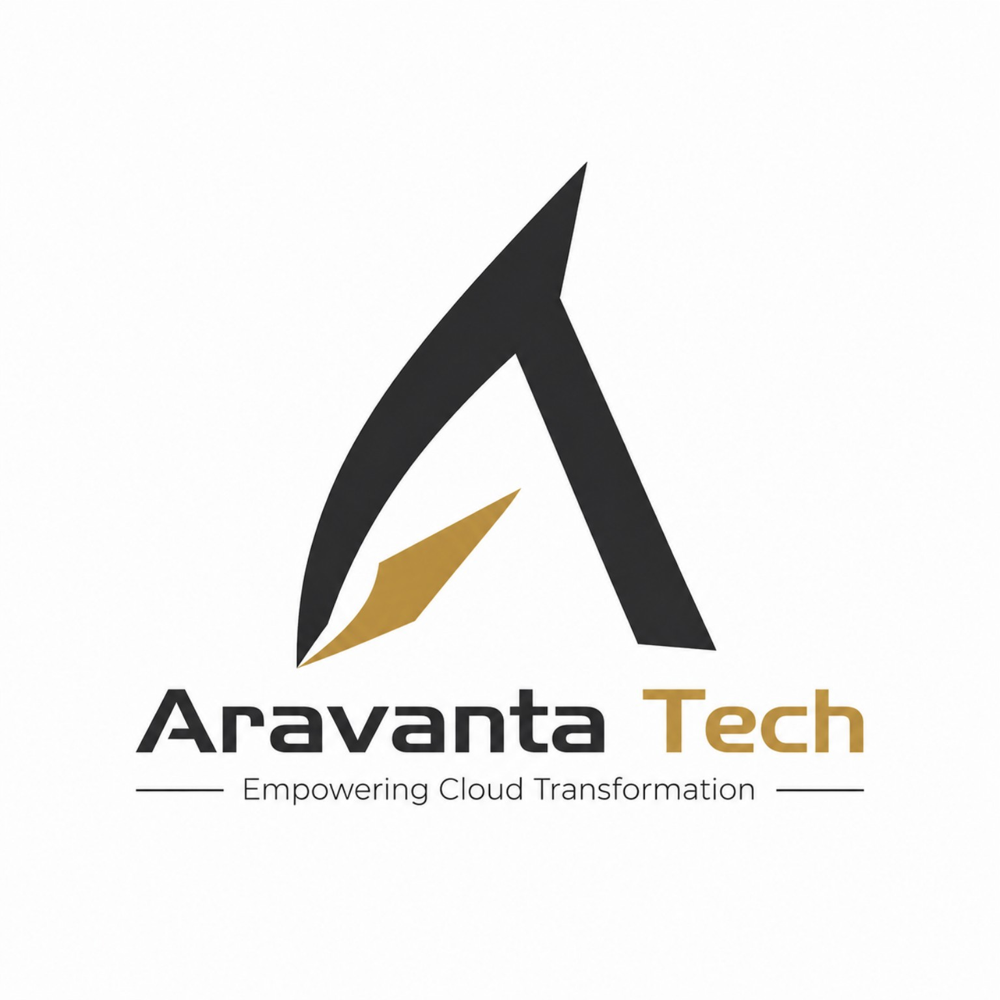

<p align="center">
  
</p>

<h1 align="center">Aravanta Tech</h1>

<p align="center">
  <strong>Empowering Cloud Transformation — Simpler. Safer. Smarter.</strong>
</p>

<p align="center">
  <a href="https://nextjs.org"></a>
  <a href="https://react.dev"></a>
  <a href="https://www.typescriptlang.org"></a>
  <a href="https://tailwindcss.com"></a>
  <a href="https://threejs.org"></a>
  <a href="https://www.framer.com/motion"></a>
</p>

---

## 🏢 About

**Aravanta Tech** is an enterprise engineering consultancy and cloud solutions provider. This repository contains the source code for the official company website — a high-performance, visually immersive web experience built with cutting-edge technologies.

The website showcases Aravanta's **7 core engineering practices**, **industry solutions**, **case study blueprints**, and the proprietary **Aravanta CloudOS** platform initiative through a cinematic, scroll-driven narrative powered by Three.js WebGL graphics.

---

## ✨ Key Features

| Feature | Description |
|---------|-------------|
| 🎬 **Cinematic 8-Scene Scroll Journey** | An immersive narrative scroll experience guiding users from cloud complexity to clarity, with synchronized Three.js 3D camera waypoints |
| 🌐 **Three.js WebGL 3D World** | Procedural isometric server cubes, data bus highways, architectural kernel rings, and mouse-following point lights |
| 📊 **Cloud Cost Calculator** | Interactive FinOps tool estimating annual waste reduction, monthly savings, and migration timelines |
| 🏗️ **CloudOS Architecture Explorer** | Multi-layer visual breakdown of the CloudOS platform with drill-down into protocols and boundary types |
| 💊 **Dynamic Island Widget** | Expandable iOS/macOS-style telemetry pill showing cluster health, uptime, and security alerts |
| 🃏 **3D Scrollable Card Stack** | Interactive perspective-stacked cards with drag, scroll, and keyboard controls featuring custom SVG blueprints |
| 🖱️ **Custom Inertial Cursor** | Dual-element pointer with smooth-lerped trailing ring that expands over interactive elements |
| ♿ **Accessibility First** | Skip-to-content link, WCAG 2.2 color contrast, reduced motion toggle for 3D animations |
| 🔍 **SEO Optimized** | Dynamic `sitemap.ts`, `robots.ts`, and OpenGraph/Twitter card metadata on every route |

---

## 🗂️ Project Structure

```
src/
├── app/                          # Next.js App Router pages
│   ├── page.tsx                  # Home — 8-scene cinematic journey
│   ├── about/                    # Company philosophy & brand
│   ├── services/                 # 7 engineering practices
│   │   ├── cloud-solutions/
│   │   ├── digital-transformation/
│   │   ├── application-development/
│   │   ├── it-infrastructure/
│   │   ├── devops-automation/
│   │   ├── cybersecurity/
│   │   └── it-consulting/
│   ├── cloudos/                  # Aravanta CloudOS platform
│   ├── solutions/                # Industry-specific solutions
│   ├── case-studies/             # Real-world blueprints & metrics
│   ├── technology/               # Technology stack capabilities
│   ├── careers/                  # Engineering culture & open roles
│   ├── contact/                  # Project scoping inquiry form
│   ├── sla/                      # Service Level Agreements
│   ├── faq/                      # Categorized enterprise FAQs
│   ├── compliance/               # SOC 2, ISO 27001, HIPAA, GDPR
│   ├── security/                 # Trust Center & zero-trust posture
│   ├── privacy/                  # Privacy policy
│   ├── terms/                    # Terms of service
│   ├── cookies/                  # Cookie policy
│   └── api/contact/              # Server-side inquiry endpoint
├── components/
│   ├── 3d/                       # Three.js WebGL components
│   ├── home/journey/             # 8-scene cinematic scroll engine
│   ├── cloudos/                  # CloudOS presentation
│   ├── contact/                  # Contact form & info
│   ├── services/                 # Service templates & explorer
│   ├── smoothui/                 # Dynamic Island & Card Stack
│   ├── layout/                   # Navbar, Footer, ScrollProgress
│   └── ui/                       # Reusable UI primitives
├── lib/
│   ├── utils.ts                  # Utility helpers (cn)
│   └── content/                  # Structured content data
├── shaders/                      # WebGL shader recipes
└── types/                        # TypeScript declarations
```

---

## 🛠️ Tech Stack

| Layer | Technologies |
|-------|-------------|
| **Framework** | Next.js 14 (App Router, Server & Client Components) |
| **Language** | TypeScript 5 |
| **Styling** | Tailwind CSS 3.4 (Custom Obsidian & Gold design system) |
| **3D / WebGL** | Three.js, @designcodeio/threeui |
| **Animation** | Framer Motion 11 (Spring physics, layout animations) |
| **Icons** | Lucide React |
| **Typography** | Geist Sans & Geist Mono (Local variable fonts) |
| **Utilities** | clsx, tailwind-merge |

---

## 📄 Pages & Routes

| Route | Description |
|-------|-------------|
| `/` | Home — Cinematic 8-scene scroll journey with 3D WebGL world |
| `/about` | Company mission, philosophy & engineering principles |
| `/services` | Overview of 7 engineering practices with interactive explorer |
| `/services/*` | Individual service deep-dives (Cloud, DevOps, Security, etc.) |
| `/cloudos` | Aravanta CloudOS platform — architecture explorer & roadmap |
| `/solutions` | Industry solutions — FinTech, SaaS, Healthcare, E-Commerce |
| `/case-studies` | Real-world blueprints with performance metrics |
| `/technology` | Battle-tested technology stack capabilities |
| `/careers` | Engineering culture & open positions |
| `/contact` | Project scoping & consultation inquiry form |
| `/sla` | Severity matrix & availability commitments (99.999% target) |
| `/faq` | Categorized enterprise FAQs |
| `/compliance` | SOC 2, ISO 27001, HIPAA, GDPR frameworks |
| `/security` | Trust Center & zero-trust security posture |

---

## 🎨 Design System

The website features a custom **Obsidian & Gold** design system:

- **Background**: Deep obsidian (`#090a0d`) with elevated surfaces
- **Accent**: Luxury gold (`#d4a342`) with glow effects and gradients
- **Typography**: Geist variable fonts for modern, clean readability
- **Animations**: Spring-physics transitions, scroll-linked parallax, and WebGL particle effects
- **Accessibility**: Reduced motion toggle, WCAG 2.2 compliant contrast ratios

---

## 📜 License

This project is proprietary software. All rights reserved © Aravanta Tech.

---

<p align="center">
  <strong>Build Smarter. Grow Faster.</strong><br/>
  <a href="https://aravantatech.com">aravantatech.com</a>
</p>